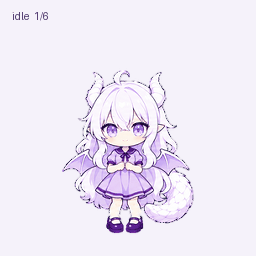

# x小龙娘 · Dragon Girl ChatGPT Pet

白发、紫瞳、浅紫色裙装的小龙少女。这里分享她的 ChatGPT 宠物版本、透明立绘和动画预览。

A white-haired, purple-eyed dragon girl companion for ChatGPT. This repository contains a transparent **ChatGPT Pet v2 sprite sheet**, a standalone character PNG, and animated GIF previews. Character inspiration is credited to **ZipZipPipe**; see [credits and rights](CREDITS.md) before reuse.

**入口 / Start here:** [添加到 ChatGPT / Add pet](https://chatgpt.com/s/sharepet_6ad0da6d320081918b1efa57b4632d00) · [选择资源 / Choose a file](#选哪个文件--choose-a-file) · [下载与校验 / Downloads](#文件--downloads) · [反馈 / Feedback](https://github.com/Marco0431/x-dragon-girl-pet/issues/new/choose)



## 选哪个文件 / Choose a file

| 你的目标 / Your goal | 使用入口 / Use this |
| --- | --- |
| 直接作为 ChatGPT 宠物使用 / Add the companion to ChatGPT | [共享页面 / Shared pet page](https://chatgpt.com/s/sharepet_6ad0da6d320081918b1efa57b4632d00)，无需克隆仓库或安装 Python / No repository clone or Python setup needed |
| 先看动作效果 / Preview the animations | [全部动作 / Animation states](all-states.gif) 与 [视线方向 / Look directions](look-loop.gif) |
| 查看透明立绘 / View the character artwork | [单张 PNG / Character PNG](x-dragon-girl.png) |
| 检查精灵图布局或在兼容客户端中使用 / Inspect the atlas or use a compatible client | [Pet v2 精灵图 / Sprite sheet](x-dragon-girl-spritesheet-v2.png) 与下方规格；使用前请阅读 [来源与权利 / Credits and rights](CREDITS.md) |

## 添加到 ChatGPT

1. [打开小龙娘共享页面](https://chatgpt.com/s/sharepet_6ad0da6d320081918b1efa57b4632d00)。
2. 在支持宠物功能的 ChatGPT 账号与客户端中，按共享页提示添加到自己的宠物收藏。
3. 从客户端的宠物收藏中选择小龙娘。无需把整张精灵图当作普通图片逐帧导入。

需要使用支持宠物功能的 ChatGPT 账号与客户端。共享页面中的宠物是独立快照，仓库文件更新不代表已有收藏会自动更新。

Open the shared pet page above and follow its instructions. A ChatGPT account and client with pet support are required. The shared pet is a snapshot; repository updates do not automatically update an existing collection entry.

## 动画预览

本版优化了待机眨眼和思考动作：延长完整睁眼与闭眼的保持感，缩短半睁眼过渡。

[查看完整状态预览 / Animation states](all-states.gif) · [查看视线方向预览 / Look directions](look-loop.gif)

## 文件 / Downloads

| 文件 / File | 内容 / Contents |
| --- | --- |
| [x-dragon-girl-spritesheet-v2.png](x-dragon-girl-spritesheet-v2.png) | 完整透明精灵图 / Transparent ChatGPT Pet v2 sprite sheet |
| [x-dragon-girl.png](x-dragon-girl.png) | 透明背景单张立绘 / Standalone character PNG |
| [all-states.gif](all-states.gif) | 主要动画状态预览 / Animation-state preview |
| [look-loop.gif](look-loop.gif) | 视线方向预览 / Look-direction preview |
| [SHA256SUMS](SHA256SUMS) | 文件完整性校验值 / File-integrity checksums |

在对应文件页面选择 **Download raw file** 保存原文件，也可通过仓库的 **Code → Download ZIP** 下载全部资源。保存时保留原扩展名，避免把预览截图当成源文件。精灵图需要按单元格和状态解析，不能直接当作循环播放的 GIF 使用。

Use **Download raw file** on a file page, or **Code → Download ZIP** for the full repository. Keep the original file extension; a screenshot of the preview is not the source asset.

### 校验下载 / Verify a download

在下载文件所在目录计算 SHA-256，并与 [SHA256SUMS](SHA256SUMS) 中同名文件一行比对。例如 Windows PowerShell：

```powershell
Get-FileHash -Algorithm SHA256 .\x-dragon-girl-spritesheet-v2.png
```

On Windows, compare the result with the matching filename in `SHA256SUMS` (letter case does not matter). On systems with `sha256sum`, run `sha256sum -c SHA256SUMS` from the extracted repository folder to check all listed files. The checksum file and assets should come from the same repository revision.

整套校验请使用同一版本的原始下载或 ZIP；Git 在 Windows 上可能转换文本文件的换行符，导致 README 等文档的哈希与下载原文不同。图像文件不受这一换行转换影响。

Use raw downloads or the ZIP for a full check: Git may convert text-file line endings on Windows, changing documentation hashes. Image hashes are unaffected by that conversion.

## 精灵图规格

- PNG，RGBA 透明背景
- 1536 × 2288 像素，8 列 × 11 行
- 每个单元格 192 × 208 像素
- 前 9 行依次为：待机、向右跑、向左跑、挥手、跳跃、失败、等待、工作／思考、检查
- 对应帧数：6、8、8、4、5、8、6、6、6
- 最后 2 行为 16 个视线方向

GIF 为预览文件；实际播放节奏由使用精灵图的客户端决定。

The RGBA sprite sheet is **1536 × 2288 px**, arranged in **8 columns × 11 rows** of **192 × 208 px** cells. The first nine rows cover idle, run right, run left, wave, hop, failure, waiting, working/thinking, and checking; the final two rows contain 16 look directions. A compatible client must interpret the cells and state timing; the PNG is not a self-playing animation.

## 来源与使用说明

角色灵感来源于社区作者 **ZipZipPipe** 的作品，本版本进行了 AI 辅助的宠物动效适配。参考线索与权利说明见 [CREDITS.md](CREDITS.md)。

本仓库公开提供下载，但没有为原角色、参考作品或整套图像素材添加 MIT、CC0 等开放授权。公开可见不等于已经取得商用、再授权或任意再分发许可；请在需要这些用途前自行确认相应权利。

本项目为社区分享，与 OpenAI 无隶属或背书关系。

This community project is not affiliated with or endorsed by OpenAI. Public availability does not grant an open-source art license or permission for commercial use, sublicensing, or redistribution. Attribution and the unverified licensing status of the original character remain documented in [CREDITS.md](CREDITS.md).

## 项目索引 / Project index

[llms.txt](llms.txt) 提供简短的英文资源索引，列出共享页面、精灵图、预览和来源说明，供读者与工具查阅。

## 常见问题与反馈 / Help and feedback

| 问题 / Question | 说明 / What to check |
| --- | --- |
| 共享页没有添加入口 / No add option on the shared page | 使用支持宠物功能的账号与客户端；记录客户端名称和版本，便于反馈 / Check pet support and include the client name and version when reporting. |
| PNG 打开后是一整张动作网格 / The PNG shows an animation grid | 这是精灵图；看动作请打开 GIF，添加宠物请走共享页面 / This is the atlas. Use the GIF to preview motion or the shared page to add the pet. |
| GIF 的背景看起来不透明 / The GIF background looks opaque | 动画预览与透明 RGBA PNG 是不同文件；要查看透明素材请下载 PNG / Download the PNG for the transparent artwork; the GIF is a preview. |
| 仓库更新了，收藏里的宠物没变 / Saved pet did not change after a repository update | 共享宠物是独立快照，已有收藏不会随仓库自动更新 / Shared pets are snapshots; repository updates do not update saved copies automatically. |

[报告显示或下载问题 / Report a display or download problem](https://github.com/Marco0431/x-dragon-girl-pet/issues/new?template=asset_feedback.md)：请说明使用的是共享页面、哪一个 PNG 或 GIF，以及异常动作/帧、客户端和版本。欢迎指出文档中不清楚的步骤；素材署名与权利问题请附可核实的来源。

Include the shared-page URL or exact filename, affected animation or frame, and client/version when reporting an issue. Documentation improvements and verifiable corrections to attribution are welcome.
