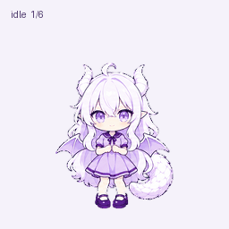

# x小龙娘 · Dragon Girl ChatGPT Pet

白发、紫瞳、浅紫色裙装的小龙少女。这里分享她的 ChatGPT 宠物版本、透明立绘和动画预览。

A white-haired, purple-eyed dragon girl companion for ChatGPT. This repository contains a transparent **ChatGPT Pet v2 sprite sheet**, a standalone character PNG, and animated GIF previews. Character inspiration is credited to **ZipZipPipe**; see [credits and rights](CREDITS.md) before reuse.

**入口 / Start here:** [添加到 ChatGPT / Add pet](https://chatgpt.com/s/sharepet_6ad0da6d320081918b1efa57b4632d00) · [动画预览](#动画预览) · [下载资源](#文件--downloads) · [项目索引 / llms.txt](llms.txt)

## 添加到 ChatGPT

[打开小龙娘共享页面](https://chatgpt.com/s/sharepet_6ad0da6d320081918b1efa57b4632d00)，按页面提示添加到自己的宠物收藏。

需要使用支持宠物功能的 ChatGPT 账号与客户端。共享页面中的宠物是独立快照，仓库文件更新不代表已有收藏会自动更新。

Open the shared pet page above and follow its instructions. A ChatGPT account and client with pet support are required. The shared pet is a snapshot; repository updates do not automatically update an existing collection entry.

## 动画预览

本版优化了待机眨眼和思考动作：延长完整睁眼与闭眼的保持感，缩短半睁眼过渡。

[查看完整状态预览 / Animation states](all-states.gif) · [查看视线方向预览 / Look directions](look-loop.gif)

## 文件 / Downloads

| 文件 / File | 内容 / Contents |
| --- | --- |
| [x-dragon-girl-spritesheet-v2.png](x-dragon-girl-spritesheet-v2.png) | 完整透明精灵图 / Transparent ChatGPT Pet v2 sprite sheet |
| [x-dragon-girl.png](x-dragon-girl.png) | 透明背景单张立绘 / Standalone character PNG |
| [all-states.gif](all-states.gif) | 主要动画状态预览 / Animation-state preview |
| [look-loop.gif](look-loop.gif) | 视线方向预览 / Look-direction preview |
| [SHA256SUMS](SHA256SUMS) | 文件完整性校验值 / File-integrity checksums |

可从对应文件页面下载原文件，也可通过仓库的 **Code → Download ZIP** 下载全部资源。精灵图需要按单元格和状态解析，不能直接当作循环播放的 GIF 使用。

## 精灵图规格

- PNG，RGBA 透明背景
- 1536 × 2288 像素，8 列 × 11 行
- 每个单元格 192 × 208 像素
- 前 9 行依次为：待机、向右跑、向左跑、挥手、跳跃、失败、等待、工作／思考、检查
- 对应帧数：6、8、8、4、5、8、6、6、6
- 最后 2 行为 16 个视线方向

GIF 为预览文件；实际播放节奏由使用精灵图的客户端决定。

The RGBA sprite sheet is **1536 × 2288 px**, arranged in **8 columns × 11 rows** of **192 × 208 px** cells. The first nine rows cover idle, run right, run left, wave, hop, failure, waiting, working/thinking, and checking; the final two rows contain 16 look directions. A compatible client must interpret the cells and state timing; the PNG is not a self-playing animation.

## 来源与使用说明

角色灵感来源于社区作者 **ZipZipPipe** 的作品，本版本进行了 AI 辅助的宠物动效适配。参考线索与权利说明见 [CREDITS.md](CREDITS.md)。

本仓库公开提供下载，但没有为原角色、参考作品或整套图像素材添加 MIT、CC0 等开放授权。公开可见不等于已经取得商用、再授权或任意再分发许可；请在需要这些用途前自行确认相应权利。

本项目为社区分享，与 OpenAI 无隶属或背书关系。

This community project is not affiliated with or endorsed by OpenAI. Public availability does not grant an open-source art license or permission for commercial use, sublicensing, or redistribution. Attribution and the unverified licensing status of the original character remain documented in [CREDITS.md](CREDITS.md).

## 项目索引 / Project index

[llms.txt](llms.txt) 提供简短的英文资源索引，列出共享页面、精灵图、预览和来源说明，供读者与工具查阅。
